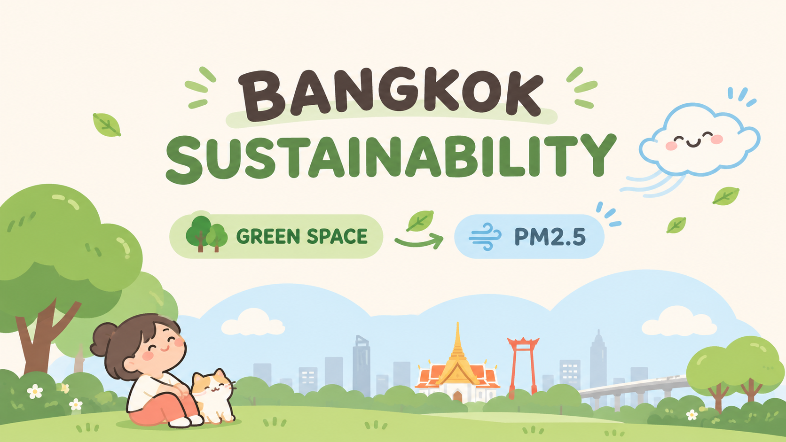
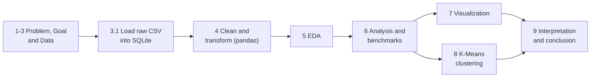
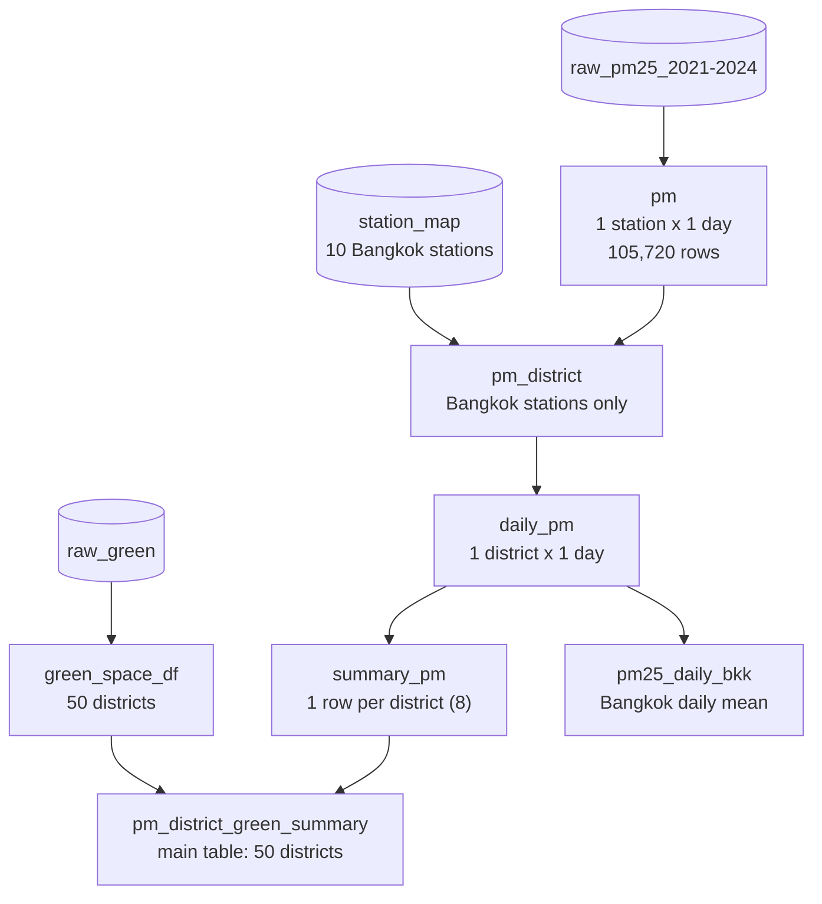
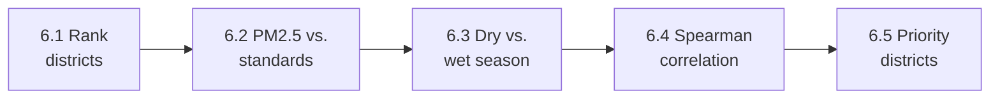
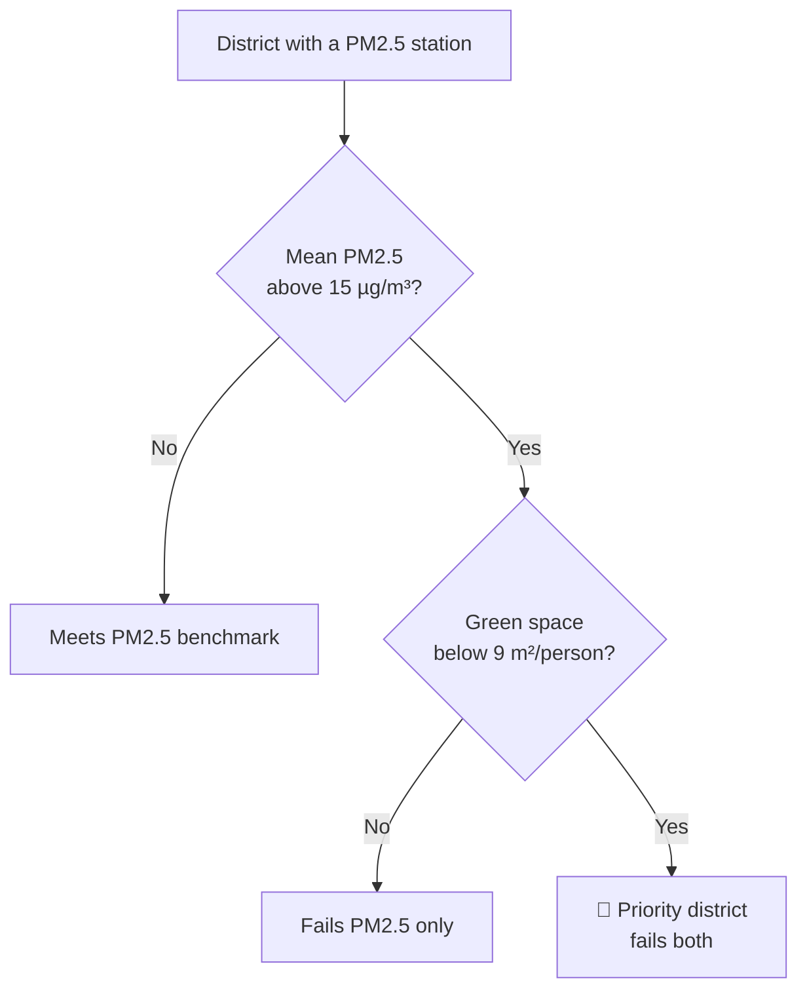
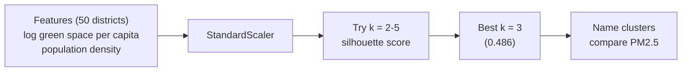

# Bangkok Sustainability: Green Space and PM2.5 Across Bangkok's Districts (2021–2024)

Course project for **2107540 Data Science for Environment and Sustainability**, Academic Year 2026 Semester 1

Main Contributors : Chatrphol Ovanonchai (with a little help from Claude Opus 5.5)

Tech Stack : Python Notebook + SQL + Pandas



> **Goal:** Is Bangkok a livable, sustainable city in terms of **air quality** and **green space**, and is this shared fairly across its districts?

---

## Results at a Glance

| Indicator | Result | Benchmark | Assessment |
|---|---|---|---|
| PM2.5 (SDG 11.6.2) | 23.5–24.1 µg/m³ per full year; all 8 monitored districts 17.9–32.2 | Thai annual 15 µg/m³ / WHO 5 µg/m³ | ❌ Fails every year |
| Green space (SDG 11.7.1) | 27 of 50 districts meet it; range 0.5–262.5 m²/person | 9 m²/person | ⚠️ Very unequal |
| Both together | Din Daeng, Thon Buri, Wang Thonglang, Phaya Thai fail both | Fail both benchmarks | 🎯 Priority districts |
| Green space vs. PM2.5 | Spearman correlation 0.02 (8 districts) | – | No relationship |

---

## Project Workflow



---

## 1. Environmental Problem

- Bangkok has high PM2.5, especially in the **dry season (November–April)**.
- PM2.5 harms respiratory and cardiovascular health; the Thai 24-hour standard is **37.5 µg/m³** (since 2023).
- Green space is **unevenly distributed**: outer districts have a lot, inner-city districts very little.
- Districts with little green space **and** high PM2.5 face a double disadvantage.

## 2. Goal and Research Questions

**Benchmarks used** (based on SDG 11: Sustainable Cities and Communities)

| Indicator | Variable | Benchmark |
|---|---|---|
| Air quality | Annual mean PM2.5, % of days above 37.5 µg/m³ | Thai annual 15 µg/m³; WHO 2021 5 µg/m³; Thai 24-hour 37.5 µg/m³ |
| Green space | Green space per capita (m²/person) | Commonly cited minimum 9 m²/person |

**Research question:** Is green space per capita associated with lower PM2.5 in Bangkok's districts?

**Sub-questions**

1. Which districts have the most / least green space per person?
2. Which districts have the highest PM2.5, and how often do they exceed the standard?
3. Does the relationship hold in the dry season?
4. Can districts be grouped into types?
5. Do Bangkok and its districts meet the benchmarks?

## 3. Datasets

| File | Content | Coverage | Source |
|---|---|---|---|
| `bangkok_green_space_by_district.csv` | Green space area, district area, population | 50 districts | [data.go.th – Bangkok green space by district](https://data.go.th/th/dataset/parkinbangkok) |
| `bangkok_pm25_2021.csv` – `bangkok_pm25_2024.csv` | Daily PM2.5 (µg/m³), one column per station | 2021–2024 (2023: Jan–Jun only), 96 stations | [data.go.th – PM2.5 Bangkok and vicinity](https://data.go.th/en/dataset/air-quality-bangkok-metropolitan-region1) |
| `station_district.csv` *(created)* | Station code → district lookup | 10 Bangkok stations → 8 districts | Air4Thai station list (Pollution Control Department) |

## 4. Data Pipeline

- Raw CSV files are loaded **as they are** into SQLite (`raw_*` tables).
- Cleaning is done in **pandas**; cleaned tables are saved back to the database.



**Cleaning steps**

| Dataset | What was done |
|---|---|
| Green space | Removed the Bangkok total row; removed `เขต` from district names; renamed columns |
| PM2.5 | Thai encoding (`cp874`) for 2021–2022; day/month/year dates in 2024; merged old/new 72T columns; removed 1 duplicate date; wide → long (`melt`); combined 4 years |
| PM2.5 → district | Kept Bangkok stations via `station_map`; averaged stations in the same district per day |

**New features**

- `green_space_per_capita` = green area (m²) / population
- `population_density` = population / district area
- `exceed_standard` = daily PM2.5 > 37.5 µg/m³
- `dry_season` = month in November–April
- Per district: `pm25_mean`, `percentage_exceed_days`, `n_days`

## 5. Exploratory Data Analysis

- **Missing values:** only in PM2.5 columns; 42 of 50 districts have no station.
- **Skewness:** green space per capita is highly right-skewed (skewness 4.45; mean 23.5 vs. median 9.6) → use log scale, median and Spearman.
- **Trend:** every year, PM2.5 peaks in December–April and is lowest in June–September.
- **Outliers:** 94 values above 200 µg/m³ exist, but none at the 10 Bangkok stations (max 137). The 9 values above 100 are in January–March → real pollution episodes, **all data kept**.

## 6. Analysis



| Step | Method | Key result |
|---|---|---|
| 6.1 Rank districts | Sort by green space per capita and by PM2.5 | Most green: Bang Khun Thian (262.5); least: Samphanthawong (0.5). Highest PM2.5: Din Daeng (32.2); lowest: Phaya Thai (17.9) |
| 6.2 Benchmarks | Bangkok yearly / monthly mean vs. 15 and 5 µg/m³ | Fails every year: 24.1, 23.7, 32.5 (half year), 23.5 µg/m³ |
| 6.3 Seasons | Mean PM2.5 per district, dry vs. wet | Dry season ≈ 1.8× wet (32.1 vs. 17.4); ~94% of days above 37.5 are in the dry season |
| 6.4 Correlation | Spearman, whole period and dry season | Green space per capita vs. PM2.5 = 0.02 → no relationship |
| 6.5 Priority | Fail both benchmarks | Din Daeng, Thon Buri, Wang Thonglang, Phaya Thai |

**How a priority district is decided**



## 7. Visualization

All figures are saved in `Figures/`.

| Figure | Shows |
|---|---|
| `green_per_capita.png` | Green space per capita, 50 districts, with the 9 m²/person line (green = meets, red = below) |
| `average_pm25_and_percentage_exceed.png` | Mean PM2.5 vs. the annual standard, and % of days above 37.5 µg/m³ (8 districts) |
| `green_vs_pm25.png` | Green space vs. PM2.5 with both benchmark lines → priority districts |
| `correlation_heatmap.png` | Spearman correlations between district variables |


## 8. Machine Learning: K-Means Clustering



- PM2.5 is **not** used to cluster (only 8 districts have it); it is compared after clustering.
- No regression model: 8 districts are too few for a reliable prediction.

| Cluster | Districts | Median green space (m²/person) | Median density (persons/km²) | Mean PM2.5 (districts with data) |
|---|---|---|---|---|
| Dense inner city, very low green | 5 | 2.8 | 12,944 | 28.7 (2 districts) |
| Urban, low green | 23 | 6.0 | 6,784 | 20.3 (2 districts) |
| Suburban, high green | 22 | 30.5 | 3,811 | 25.6 (4 districts) |

## 9. Interpretation

- **Not yet sustainable:** PM2.5 fails the standard everywhere it is measured; green space is very unequal.
- **No link:** more green space per person does not mean lower PM2.5.
- **Why:** PM2.5 is a city-wide, seasonal problem (temperature inversion, weak wind, no rain, biomass burning), stronger than district-level green space.
- **Policy:**
  - Reduce PM2.5 with city-wide and regional action (traffic emissions, open burning).
  - Add green space first in the priority and inner-city districts, for fair access.
  - Expand PM2.5 monitoring beyond 8 districts.

**Limitations**

- PM2.5 covers only **8 of 50 districts** (10 stations) → results not statistically significant.
- Station readings (often roadside) do not represent a whole district.
- 2023 has January–June only → its mean is biased upward.
- No weather or emission data; the dry/wet split is only a proxy.
- Green space data are one snapshot; 9 m²/person is a commonly cited value, not an official standard.
- Correlation does not imply causation.

---

## Repository Structure

```
Part I Notebook/
├── README.md
├── requirements.txt
├── Data/                     raw CSV files (green space, PM2.5 2021–2024, station lookup)
├── Database/
│   └── bangkok_sustainability.db   SQLite: raw_* tables + cleaned tables
├── Figures/                  saved charts (Section 7)
├── Misc/                     cover page image
└── Notebooks/
    └── 2107540_Project_BangkokSustainability.ipynb
```

## How to Run

```bash
pip install -r requirements.txt
cd "Part I Notebook/Notebooks"
jupyter notebook 2107540_Project_BangkokSustainability.ipynb
```

- Run the notebook **from the `Notebooks/` folder** (paths use `../Data`, `../Database`, `../Figures`).
- Run all cells in order; the database and figures are recreated automatically.
